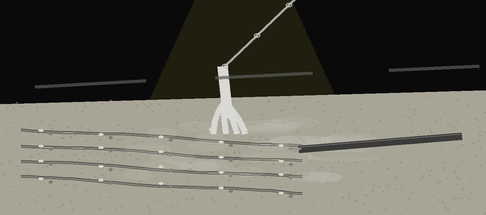

# artex-executablemetadatascanner

# artex-ExecutableMetadataScanner

> Fray box: if a YARA rules file named with -r cannot be compiled, the report carries a yara_error field describing the compile failure and the run exits 1.

> Fray box: a rules file that does not exist also exits 1.
Scans executable files (PE, ELF, Mach-O) to extract metadata such as compiler information, timestamps, imported libraries, and embedded resources.  Uses `pefile` (for PE), `lief` (for ELF/Mach-O), and `yara-python` to identify suspicious characteristics based on YARA rules. Outputs a report highlighting potential red flags. If a YARA rules file named with `-r` cannot be compiled, the report carries a `yara_error` field describing the compile failure and the run exits 1, because the YARA part of the scan was not performed. A rules file that does not exist also exits 1. - Focused on Automated extraction of indicators of compromise (IOCs) and metadata from document and binary files. Focus on speed and accuracy, allowing quick triage of potentially malicious artifacts.

## Install
`git clone https://github.com/ShadowStrikeHQ/artex-executablemetadatascanner`

## Usage
`./artex-executablemetadatascanner [params]`

## Parameters
- `-h`: Show help message and exit
- `-r`: Path to YARA rules file (optional)
- `-o`: Path to save the JSON report (optional)
- `-v`: Enable verbose logging

## License
Copyright (c) ShadowStrikeHQ
